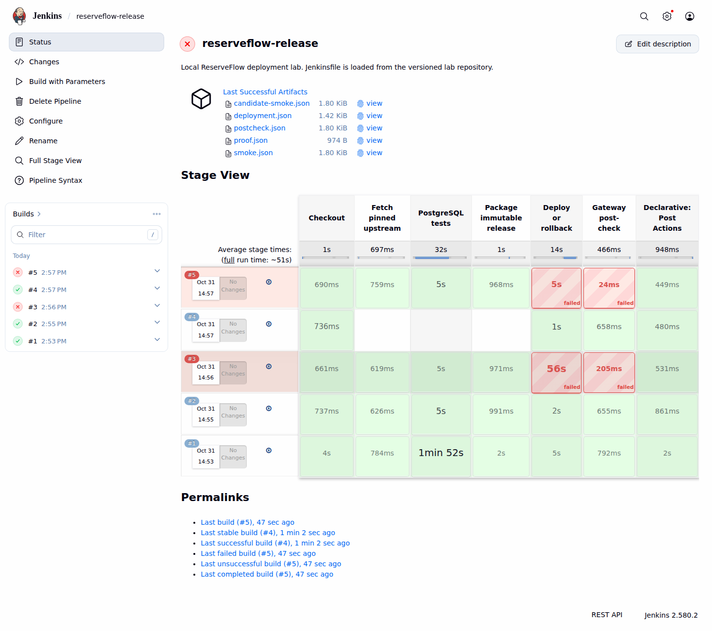
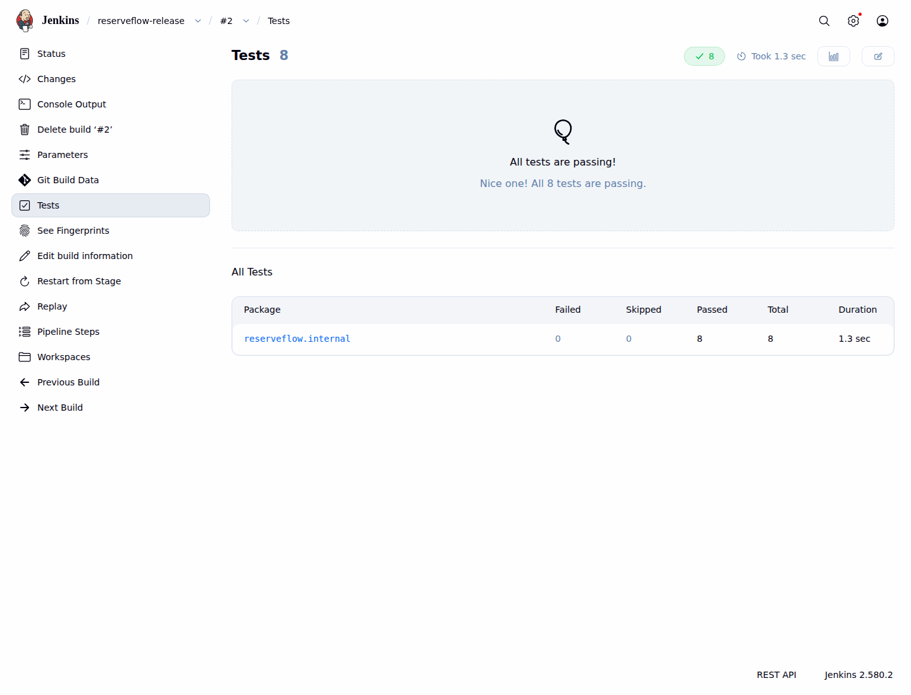
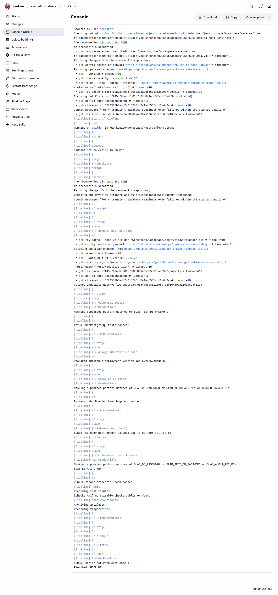
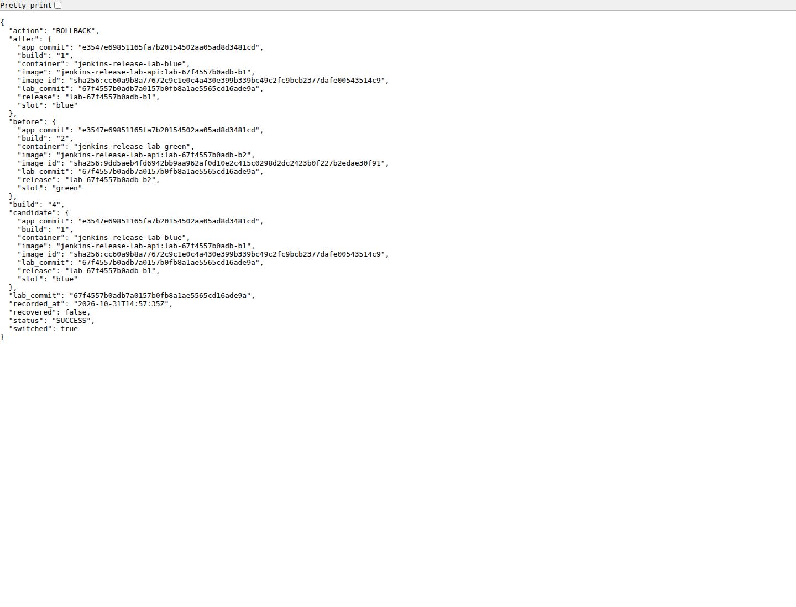

# Jenkins Release Lab

Lab CI/CD lokal untuk merilis [ReserveFlow API](https://github.com/zalamanga/reserveflow-api) melalui Jenkins sungguhan. Jenkins membaca pipeline dari Git, menjalankan tes dengan PostgreSQL, membangun image, lalu memindahkan trafik gateway antara slot blue dan green. Kandidat yang gagal health check tidak menerima trafik. Kegagalan setelah perpindahan memicu pemulihan otomatis.

Lab memakai source aplikasi yang tetap: `e3547e69851165fa7b20154502aa05ad8d3481cd`. Dua deployment sehat membuat release ID baru dari source yang sama. Demonstrasi ini menguji proses rilis, bukan perubahan fitur aplikasi. Checkout ReserveFlow berada di workspace privat Jenkins; lab tidak mengubah repository aplikasi asal.

## Yang dipelajari

- Controller mengelola job dan build history dengan 0 executor. Satu inbound agent memiliki 1 executor untuk pekerjaan build.
- Jenkins Configuration as Code mengatur controller, node, dan kredensial. Bootstrap membuat job yang memakai [Jenkinsfile](Jenkinsfile) dari SCM.
- Suite aplikasi menjalankan delapan tes Go dengan PostgreSQL tersedia: tujuh tes integrasi database dan satu tes unit. Jenkins menampilkan hasilnya melalui JUnit dan menyimpan laporan publik per build.
- Image rilis memakai identitas tersendiri. Deployment menyimpan image ID agar rollback dapat membuat ulang container sebelumnya.
- Health gate, post-check, manual rollback, dan kegagalan yang disengaja memiliki hasil build yang bisa diperiksa.
- PostgreSQL deployment memakai volume lab yang sama selama pergantian slot. Sentinel sintetis membuktikan data bertahan.

## Bukti pelaksanaan

[Verifikasi Jenkins di CI](https://github.com/zalamanga/jenkins-release-lab/actions/runs/41211924065) lulus pada source lab [`67f4557b0adb`](https://github.com/zalamanga/jenkins-release-lab/tree/67f4557b0adb7a0157b0fb8a1ae5565cd16ade9a). **34 tes Python dan delapan kasus Go lulus.** Lima skenario Jenkins juga lulus verifikasi pada runner Ubuntu dan Docker Desktop Windows. Setiap probe smoke lengkap mengirim 12 request HTTP.

Dua build merah pada gambar adalah skenario gangguan yang disengaja. Kandidat tidak sehat ditolak, sedangkan gangguan setelah cutover memicu recovery. Verifier memeriksa image aktif, hash state dan data sintetis sesudahnya. Status workflow keseluruhan adalah `SUCCESS`.



Screenshot berasal dari UI klasik Jenkins pada runner CI. Build #1 dan #2 adalah deployment sehat, #3 kandidat ditolak, #4 rollback, dan #5 gangguan setelah cutover dengan layanan dipulihkan. [Laporan CI](docs/evidence/ci-verification.json), [laporan Windows](docs/evidence/windows-verification.json), dan [identitas serta hash gambar](docs/evidence/manifest.json) menyimpan bukti yang dapat diperiksa.

<details>
<summary>Lihat hasil tes, penolakan kandidat, dan rollback</summary>

Delapan kasus Go ditampilkan pada halaman JUnit Jenkins.



Console build kandidat tidak sehat mencatat health gate yang menolak rilis.



Artifact rollback mencatat image ID release awal yang dipulihkan.



</details>

## Menjalankan lab

Prasyarat host: Docker dengan Linux containers dan Compose v2, Git, Python 3.11+, serta PowerShell untuk script Windows. Dari root repository:

```powershell
.\scripts\Start.ps1
.\scripts\Verify.ps1
.\scripts\Stop.ps1
```

Panduan kredensial lokal dan troubleshooting tersedia di [panduan operasi](docs/OPERATIONS.md). Jenkins berada di `http://127.0.0.1:8110`; API melalui gateway berada di `http://127.0.0.1:8111`. Database dan Docker daemon tidak menerbitkan port ke host. Script Stop mempertahankan volume dan data lab.

Jalankan satu build pada satu waktu. Java 21 berada di image Jenkins, sehingga Java 17 native tidak perlu diganti. Source, laporan lokal, dan cache proyek berada di drive D pada workspace Windows yang digunakan untuk lab. Konfigurasi global Docker Desktop tidak diubah oleh proyek ini.

## Empat aksi pada satu job

| Nilai `ACTION` | Perilaku yang diperiksa | Hasil yang diharapkan |
|---|---|---|
| `DEPLOY_GOOD` | Tes, build image, health gate, pindah trafik, lalu HTTP smoke | `SUCCESS` |
| `DEPLOY_UNHEALTHY` | Kandidat gagal sebelum trafik berpindah | `FAILURE`, active release tetap |
| `ROLLBACK` | Pulihkan image ID sebelumnya, termasuk bila container slotnya sudah hilang | `SUCCESS` |
| `DEPLOY_POSTCHECK_FAIL` | Gangguan setelah cutover memaksa pemulihan ke active release sebelumnya | `FAILURE`, layanan pulih |

Status `FAILURE` pada dua skenario gangguan adalah hasil yang diharapkan. Laporan verifikasi membedakan kegagalan yang disengaja dari kegagalan lab.

## Membaca proyek

| Dokumen | Isi |
|---|---|
| [Panduan kode](docs/CODE-GUIDE.md) | Peran setiap file dan fungsi utama, beserta urutan membacanya |
| [Arsitektur](docs/ARCHITECTURE.md) | Controller, agent, DinD, jaringan, blue-green, state dan batas kepercayaan |
| [Operasi](docs/OPERATIONS.md) | Menyalakan lab, menjalankan job, mengambil bukti dan menghentikan stack |
| [Persiapan interview](docs/INTERVIEW.md) | Penjelasan keputusan dan batas demonstrasi |
| [Catatan verifikasi](docs/VERIFICATION.md) | Prosedur, hasil terukur dan lokasi bukti |
| [Tinjauan UX](docs/UX-REVIEW.md) | Lingkup pemeriksaan, alur UI dan hasil katalog portfolio |

## Batas lab

Ini adalah Jenkins lokal untuk portofolio dan latihan. Repository, laporan publik terpilih, serta screenshot dapat dipublikasikan. Controller Jenkins tidak memiliki endpoint publik dan tidak dihosting pada GitHub Pages. GitHub Actions, bila dijalankan, menyalakan stack yang sama dan menggerakkan job melalui API Jenkins; runner GitHub tidak menggantikan Jenkins sebagai mesin pipeline.

Agent memakai Docker client menuju daemon DinD lab melalui mutual TLS. Proyek tidak memasang socket Docker host. Container daemon DinD tetap memerlukan mode privileged dan menyimpan data di volume milik lab. Pemisahan ini membatasi sasaran perintah Docker lab; ini bukan klaim isolasi produksi. Lihat [batas keamanan dan penyimpanan](docs/ARCHITECTURE.md#batas-kepercayaan).

## Referensi

Konsep dasar mengikuti dokumentasi resmi [Jenkins agents](https://www.jenkins.io/doc/book/using/using-agents/), [Pipeline as Code](https://www.jenkins.io/doc/book/pipeline-as-code/), [JUnit dan artifact](https://www.jenkins.io/doc/pipeline/tour/tests-and-artifacts/), serta [Docker daemon melalui TLS](https://docs.docker.com/engine/security/protect-access/).
