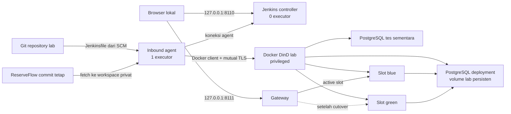

# Arsitektur Jenkins Release Lab

Lab memisahkan pengaturan Jenkins, eksekusi build, dan runtime aplikasi. Controller menyimpan konfigurasi serta build history. Agent menjalankan pipeline. Docker daemon DinD membuat container tes dan deployment di dalam lingkungan lab.

Diagram menunjukkan hubungan logis. Port database serta port daemon hanya digunakan di jaringan container, tanpa pemetaan port host.

## Controller dan agent

Controller mengurus antrean, penjadwalan, konfigurasi, autentikasi, hasil tes, artifact, dan build history. Nilai executor controller adalah 0. Jenkins menyarankan build berjalan pada agent agar pekerjaan build tidak memakai filesystem controller secara langsung. Lihat [controller isolation](https://www.jenkins.io/doc/book/security/controller-isolation/).

Inbound agent membuat koneksi WebSocket ke controller melalui jaringan lab. Port TCP inbound agent dimatikan; agent tidak membutuhkan port host tersendiri. Label node pada pipeline memilih agent tersebut. Satu executor berarti agent menerima satu pekerjaan build pada suatu waktu; pipeline juga menonaktifkan build bersamaan. Pilihan ini sesuai lab dengan RAM 8 GB dan mengurangi perubahan deployment yang saling tumpang tindih. Penjelasan executor dan label tersedia di [dokumentasi agents](https://www.jenkins.io/doc/book/using/using-agents/).

Image Jenkins menyediakan Java 21 di container. Java 17 pada Windows tidak ikut menjalankan controller atau agent. Tool aplikasi seperti Go berjalan sesuai image build dan tes yang dicatat dalam konfigurasi lab.

## Konfigurasi dapat diperiksa

Jenkins Configuration as Code (JCasC) membaca YAML untuk mengatur controller, node, dan kredensial. Bootstrap membuat job pipeline yang memuat [Jenkinsfile](../Jenkinsfile) dari SCM agar perubahan pipeline tercatat bersama source lab. JCasC menyiapkan Jenkins, bootstrap menghubungkan job dengan SCM, dan Jenkinsfile mengatur langkah sebuah build. Lihat [JCasC](https://plugins.jenkins.io/configuration-as-code/) dan [Jenkinsfile](https://www.jenkins.io/doc/book/pipeline/jenkinsfile/).

Kredensial berasal dari berkas lokal yang diabaikan Git. Konfigurasi memakai referensi kredensial; dokumentasi dan artifact tidak menyimpan nilainya. Variabel yang berisi secret tidak boleh ditempel pada nama build, system message, screenshot, atau laporan. JCasC melakukan interpolasi konfigurasi, sehingga lokasi interpolasi tetap perlu ditinjau.

## Dua identitas source

Commit repository lab menjelaskan versi pipeline dan release engine. Commit ReserveFlow `e3547e69851165fa7b20154502aa05ad8d3481cd` menjelaskan source aplikasi yang dibangun. Keduanya harus dapat dibaca pada bukti build.

Setiap deployment sehat menghasilkan release ID baru dari commit aplikasi yang sama. Nomor build atau release ID membedakan dua eksekusi pipeline; itu tidak menunjukkan adanya fitur aplikasi baru. Pipeline mengambil source ReserveFlow ke direktori privat di workspace Jenkins, sehingga checkout asli di luar lab tetap utuh.

## Alur satu deployment

1. Jenkins membaca pipeline lab dari SCM dan menyiapkan workspace pada agent.
2. Fetch memeriksa commit aplikasi yang telah dipatok.
3. Container tes menjalankan tes Go dengan PostgreSQL sementara. Parser membuat JUnit dari keluaran tes yang benar-benar dijalankan dan menolak tes yang hilang atau dilewati.
4. Build menghasilkan image rilis. Release engine mencatat tag, image ID, identitas source, dan release ID.
5. Engine menyiapkan kandidat pada slot yang tidak aktif, dengan database deployment yang sama.
6. Health gate memeriksa kandidat sebelum gateway memilihnya.
7. Gateway berpindah ke kandidat. HTTP smoke memeriksa perilaku API melalui jalur trafik tersebut.
8. Engine menyimpan state serta laporan, dan Jenkins mengarsipkan laporan yang dipilih.

Tes integrasi dan HTTP smoke memiliki tugas berbeda. Tes Go memeriksa transaksi serta konkurensi dengan database nyata. Smoke memeriksa jalur HTTP deployment dan gateway. Keberadaan endpoint health tidak menggantikan pemeriksaan perilaku API.

## Blue-green dan pemulihan

State menyimpan active release dan previous release. Masing-masing memuat identitas image yang dibangun. Slot blue dan green adalah tempat menjalankan container; image ID adalah identitas isi image. Perbedaan ini diperlukan ketika sebuah container sudah tidak ada. State history hanya memuat perubahan yang berhasil, sedangkan history percobaan privat mencatat juga deployment yang gagal.

Pada `DEPLOY_UNHEALTHY`, engine sengaja membuat kandidat yang tidak lolos pemeriksaan. Gateway tetap menunjuk active release. Build gagal dan laporan merekam alasan penolakan.

Pada `ROLLBACK`, engine memilih previous image ID. Bila container previous sudah hilang, engine membuat ulang container dari image tersebut, menjalankan health gate, lalu memindahkan gateway. Database tidak dikembalikan ke snapshot lama.

Pada `DEPLOY_POSTCHECK_FAIL`, gangguan terjadi setelah cutover. Engine mengembalikan gateway ke release sebelumnya, memeriksa pemulihan, dan tetap menandai build gagal. Keberhasilan pemulihan tidak menghapus kegagalan deployment.

## Data yang bertahan

Database tes bersifat sementara dan terpisah dari database deployment. Database deployment memakai volume lab persisten yang sama pada kedua slot. Verifikasi menulis sentinel sintetis, lalu memeriksanya setelah deployment, penolakan kandidat, rollback, dan pemulihan otomatis.

Sentinel membuktikan baris tersebut masih ada pada rangkaian yang diuji. Bukti ini tidak menjamin kompatibilitas semua perubahan skema. ReserveFlow pada commit yang dipatok tidak menyediakan framework migrasi upgrade; demonstrasi memakai source yang sama dan tidak menjalankan migrasi merusak.

Perintah penghentian memakai Compose `down` tanpa `-v`. Menghapus volume merupakan tindakan terpisah yang membuang data; prosedur normal lab tidak melakukannya.

## Batas kepercayaan

Agent terhubung ke Docker daemon lab melalui mutual TLS. Client memeriksa sertifikat server, dan daemon memeriksa sertifikat client. Agent berjalan sebagai UID 1000, melepas Linux capabilities, memakai `no-new-privileges`, dan memasang volume sertifikat client secara read-only. Kunci client memberikan kendali atas daemon tersebut sehingga tetap merupakan secret. Lihat [dokumentasi perlindungan daemon Docker](https://docs.docker.com/engine/security/protect-access/).

Lab tidak memasang socket Docker host ke controller maupun agent. DinD menyimpan image, container, network, dan volume di ruang data daemon lab. Container DinD memakai mode privileged agar daemon bersarang dapat berjalan. Host tetap mempercayai container privileged tersebut; konfigurasi ini bukan sandbox produksi untuk kode tak tepercaya.

Hanya Jenkins dan gateway memetakan port host, masing-masing pada loopback. Database serta daemon Docker tidak menerbitkan port host. Tidak ada akun cloud, host berbayar, atau endpoint Jenkins publik yang diperlukan.

## Bukti yang boleh dipublikasikan

Jenkins mengarsipkan JSON dan XML laporan yang tidak memuat secret. Screenshot berasal dari UI klasik Jenkins yang benar-benar berjalan. Direktori controller home, workspace privat, `.env`, berkas kredensial, sertifikat, dan log privat tidak termasuk artifact publik.

GitHub Actions menyiapkan stack lokal pada runner, kemudian memanggil API Jenkins untuk menjalankan dan memeriksa build. Bukti Jenkins adalah nomor build, hasil, stage, JUnit, dan artifact yang diambil dari controller tersebut. Status workflow saja tidak membuktikan bahwa seluruh skenario rilis lolos; verifier memeriksa hasil tiap skenario.
